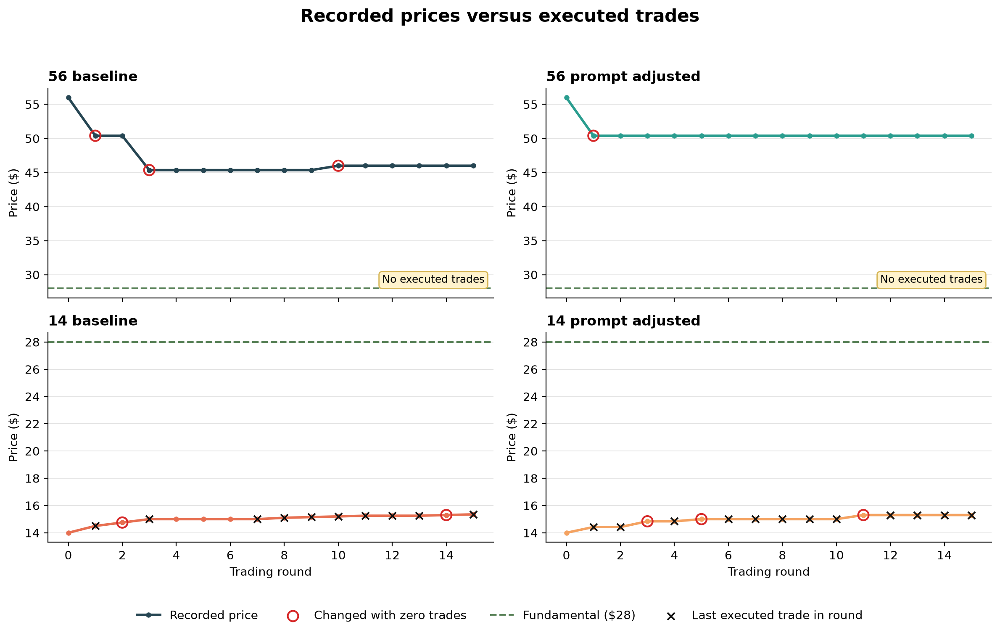
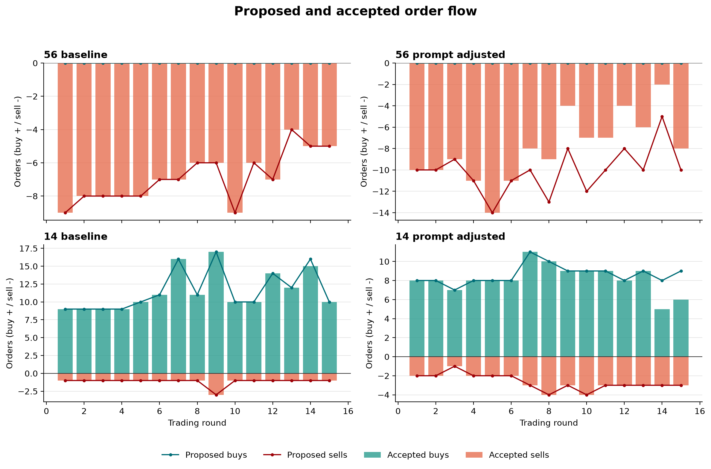
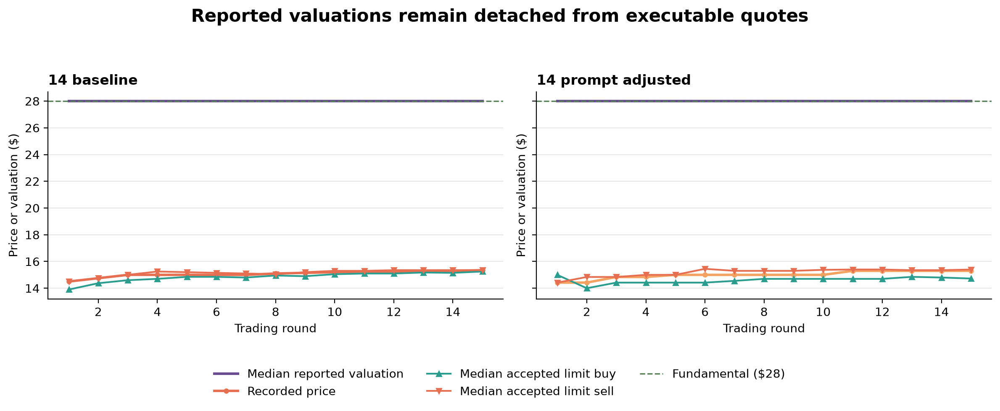
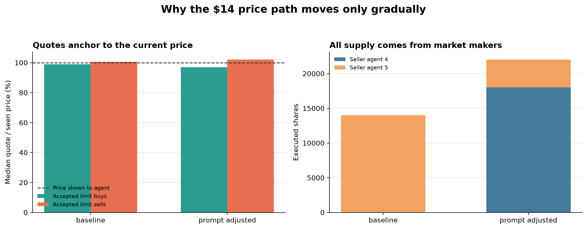

# Figure 6–7 canonical mechanism analysis

**Date:** October 21, 2026  
**Scope:** Four existing 15-round runs; no new API calls  
**Question:** Do these runs show transaction-based price discovery toward the $28 fundamental value, and where does the price-formation chain break down?

## Executive finding

The current runs do not reproduce the paper's reported strong upward convergence from $14, and the apparent downward movement from $56 is entirely quote driven. The key bottleneck appears before matching: in both $56 runs, the model proposed no buy orders at all. Every active decision was a sell, including almost every market-maker decision. With no buy side, no trades could occur. The simulator nevertheless reduced its recorded price by selecting an order-book quote when a round had no trades.

The $14 runs did produce real transactions, but agents placed accepted limit orders close to the prevailing price rather than close to their reported $28 valuations. All executed sell-side supply came from the market makers; in the baseline, one market maker supplied every executed share. Consequently, the final transaction prices were only $15.35 and $15.30. The evidence therefore separates two mechanisms: missing buy-side liquidity in the high-price condition and a concentrated, price-anchored supply mechanism in the low-price condition.

These results diagnose the current public implementation and these four paths. They do not identify a causal AI-herding effect or refute the paper's historical results.

## Data and definitions

The analysis joins five sources from each run:

1. `structured_decisions.csv`: model-reported valuation and proposed orders;
2. `order_data.csv`: orders accepted into the market process;
3. `order_state.txt`: curated copy of the market-level validation log;
4. `trade_data.csv`: executed transactions;
5. `market_data.csv`: simulator-recorded price and available book snapshots.

The decision logger numbers rounds 0–14, whereas the market, order, and trade files number them 1–15. The analysis shifts decision rounds by one before joining. Agent valuations are deduplicated by agent and round because one decision may contain multiple orders.

Three price concepts are kept separate:

- **Recorded price:** the simulator's `current_price`. It is the last trade price when a trade occurs, but it can be replaced by an order-book quote when no trade occurs.
- **Executed trade price:** a price from `trade_data.csv`, demonstrating agreement between a buyer and seller.
- **Midpoint:** the mean of synchronized best bid and best ask. It is undefined when either side is absent. The older baseline logs do not contain synchronized post-match quotes, so a valid midpoint cannot be reconstructed from those rows.

Relative pricing error is

\[
PE_t = \frac{|P_t-28|}{28}.
\]

The report labels which price measure supplies \(P_t\). Transaction PE is unavailable for the $56 runs because no transaction occurred.

## Run-level results

| Run | Agent-round direction pattern | Accepted buy/sell orders | Market validation failures | Trades / volume | Final recorded price | Last executed trade | Final recorded PE | Share of absolute recorded movement occurring in zero-trade rounds |
|---|---|---:|---:|---:|---:|---:|---:|---:|
| $56 baseline | 72 sell-only; 48 hold | 0 / 103 | 0 | 0 / 0 | $46.00 | NA | 64.3% | 100.0% |
| $56 prompt adjusted | 95 sell-only; 25 hold | 0 / 120 | 31 share failures | 0 / 0 | $50.40 | NA | 80.0% | 100.0% |
| $14 baseline | 105 buy-only; 15 both sides | 172 / 17 | 1 cash failure | 23 / 13,999 | $15.35 | $15.35 | 45.2% | 22.2% |
| $14 prompt adjusted | 87 buy-only; 29 both sides; 4 hold | 123 / 40 | 6 cash failures | 24 / 22,000 | $15.30 | $15.30 | 45.4% | 67.7% |

“Agent-round direction” describes each of the 120 agent decisions per run. “Accepted orders” counts individual orders, so one agent decision can contribute more than one order. The quote-movement share uses absolute round-to-round recorded-price changes; it shows how much displayed movement occurred in rounds with no trades.

The full generated tables are [`canonical_run_summary.csv`](tables/canonical_run_summary.csv), [`canonical_round_audit.csv`](tables/canonical_round_audit.csv), [`canonical_agent_decision_summary.csv`](tables/canonical_agent_decision_summary.csv), and [`canonical_mechanism_summary.csv`](tables/canonical_mechanism_summary.csv).

## Finding 1: all high-price movement is quote driven



Both $56 runs contain 15 zero-trade rounds. Therefore, they have no transaction-price path. All changes in the recorded price occurred through the no-trade order-book fallback:

- baseline: $56 → $50.40 → $45.36 → $46.00;
- prompt adjusted: $56 → $50.40, followed by no further recorded movement.

When no trade occurs, the current implementation chooses the best ask whenever any sell order is present; it chooses the best bid only when the book contains buys and no sells. An unfilled market sell can also be converted to an aggressive limit order at 90% of the best bid, or 90% of the current price when no bid exists. Thus, $56 × 0.90 = $50.40 can become the recorded price without buyer acceptance.

The high-price runs demonstrate lower sell quotes and severe buy-side absence. They do not demonstrate transaction-based downward price discovery or an executed crash.

## Finding 2: the absent buy side originates in model decisions



The model proposed zero buy orders in both $56 runs. This rules out two alternative explanations for the missing buy side: buy orders were not removed by the matching engine, and they were not rejected by financial constraints. They were never proposed.

The heterogeneous agent labels did not generate directional diversity under this condition:

- In each $56 run, market makers made sell-only decisions in 28 of 30 agent-rounds and held in 2. They never posted both sides, despite their assigned liquidity-provision role.
- Default, Optimistic, and Speculator agents also selected only sell or hold.
- All reported valuations were below $56: six agents generally reported $28, and the two Optimistic agents reported $41.60. Their active decisions therefore followed the shared sign of the price-to-valuation gap.

This is evidence of aligned decision-making under a common market signal. It is not yet evidence that prompt similarity caused the alignment, because there is no prompt-diversity treatment or otherwise matched control.

## Finding 3: resource validation is a separate, previously hidden layer

The difference between proposed and accepted orders is fully explained by market validation messages in `order_state.log`:

- $56 prompt adjusted: 151 proposed sells, 120 accepted, and 31 rejected because owned shares were already unavailable and the borrowing pool contained zero lendable shares;
- $14 baseline: one proposed buy rejected for insufficient cash;
- $14 prompt adjusted: six proposed buys rejected for insufficient cash.

The `validation_errors.csv` files contain zero rows because they capture a different validation layer, primarily model-output validation. They do not establish that every proposed market order passed cash and inventory checks. Future reporting should therefore inspect both the structured-output validation file and the order-state log.

In the adjusted $56 run, the no-trade environment allowed outstanding sell orders to reserve inventory without releasing it through execution. Agents then continued proposing sells, producing the 31 share-related failures. These failures reduced accepted sell supply but cannot explain the lack of buyers.

## Finding 4: stated valuations do not pass through to executable quotes



In both $14 runs, the round-level median reported valuation was $28 from the first round onward. Accepted limit quotes stayed near $14–$15 instead:

- baseline median limit buy price was 53.2% of the submitting agent's reported valuation; median limit sell price was 54.3%;
- prompt-adjusted median limit buy price was 52.0% of valuation; median limit sell price was 54.8%.

This is why the existence of a $28 reported valuation does not imply rapid convergence to $28. Agents distinguish their fundamental-value field from their tactical order prices and anchor their orders near the prevailing market. Those orders can trade with each other, but only around the existing price. The result is real volume with limited correction.

The low-price runs closed only 9.6% and 9.3% of the initial distance to $28. Their final transaction PEs were 45.2% and 45.4%, compared with the initial 50% error.

## Finding 5: the low-price transaction path is controlled by market-maker supply



Joining accepted orders to the exact rendered prompt shows that limit prices were anchored tightly to the last price shown to the submitting agent:

| Run | Median limit buy / seen price | Median limit sell / seen price | Market-maker decisions quoting both sides | Unique executed sellers | Largest seller's volume share |
|---|---:|---:|---:|---:|---:|
| $56 baseline | NA | 101.4% | 0 / 30 | 0 | NA |
| $56 prompt adjusted | NA | 101.2% | 0 / 30 | 0 | NA |
| $14 baseline | 99.0% | 100.7% | 15 / 30 | 1 | 100.0% |
| $14 prompt adjusted | 97.0% | 102.0% | 29 / 30 | 2 | 81.8% |

In the $14 baseline, every executed seller was market-maker agent 5. In the adjusted run, the two market makers supplied every executed share, with agent 4 providing 81.8% of volume. Other agent types supplied buy demand but no executed sell supply. This provides a concrete explanation for the gradual path: transaction prices can rise only as the market makers raise their asks, and their prompt instructs them to quote only 1--3% around the current market price. It does not instruct them to move asks directly toward fundamental value.

The high-price failure has the complementary form. Although the market-maker system prompt describes two-sided liquidity provision, neither market maker submitted both sides in any of its 30 decisions. Their recorded reasoning instead compares $56 with their independently calculated $28 valuation and chooses directional selling. This identifies a role-compliance conflict between the system prompt's market-making instruction and the valuation-oriented decision task. The trace establishes where the conflict appears, but a prompt ablation is still required to identify which wording causes it.

## Code and prompt provenance result

The local Git history distinguishes current-implementation findings from claims about the paper's original run:

| Component | Earliest public repository state | State used in these runs | Implication |
|---|---|---|---|
| Public availability | First visible commit: June 13, 2025 | Commit `a09d51b` | The public history begins after the paper submission, so it cannot identify the exact Figure 6--7 snapshot. |
| No-trade recorded price | Best ask if sells exist; best bid only if the book contains buys and no sells | Same rule | The quote-fallback mechanism was not added by our team; it was present from the first public commit. |
| Unfilled market sell | Converted to a limit at 90% of best bid, or 90% of current price if no bid exists | Same rule | The mechanical $56 to $50.40 step is also present in the earliest public code. |
| Market-maker system prompt | Explicitly prohibits short selling and gives stronger no-short inventory instructions | Current baseline says short selling is permitted when borrowing is available; our treatment changed this wording but was not a byte-exact historical replay | Prompt drift is real, but our previous treatment does not isolate the earliest-public prompt. |
| User-prompt response task | Requests one next-round price target | Requests price predictions for the current and next two rounds | The decision context/schema also changed, so changing only the market-maker short-sale sentence cannot reconstruct the earlier behavior. |
| Model/scenario packaging | Initial public defaults specify `gpt-4o-2024-11-20`; the dedicated `paper_scenarios.py` file is not present in the first commit | Our logs explicitly use `gpt-4o-2024-11-20`; the current `paper_scenarios.py` first appears much later in visible history and now names `gpt-oss-120b` | Our model choice is auditable, but the current file labelled as a frozen paper scenario is not an archival snapshot of the publication-time setup. |
| Infinite-horizon scenario | 15 rounds, $56/$14 starts, eight agents with the same four role categories | Same high-level design | The scenario skeleton is historically visible, while the exact prompt/model/code combination used for the published figures is not. |

This audit supports a precise conclusion: the observed quote-only price movement is a property of the author's public implementation, not a local research-team modification. It does **not** establish that the same implementation generated the paper's figures.

## Replication assessment

| Paper result examined | Evidence from current runs | Assessment |
|---|---|---|
| $56 price remains substantially above $28 | Recorded prices end at $46.00 and $50.40 | Directionally consistent |
| $56 path represents price discovery | Zero transactions; all movement comes from quote fallback | Cannot support a transaction-based interpretation |
| $14 price clearly converges toward $28 | Final transaction prices are $15.35 and $15.30 | Not reproduced |
| High-price valuations remain elevated | Median valuation is $28 throughout; two Optimistic agents report $41.60 | Reported Figure 7 pattern not reproduced at the median |
| Low-price valuations adjust upward | Median begins at $28 and remains there | Dynamic adjustment not reproduced |
| Clarifying the market-maker short-sale wording resolves the discrepancy | Zero-trade high-price outcome and weak low-price correction persist | Wording contradiction is not a sufficient explanation |

The prompt comparison is not a causal estimate because the baseline and adjusted runs realized different dividend paths and LLM outputs can vary even with temperature 0 and a fixed seed.

## What is resolved and what remains open

Resolved from existing data:

- The $56 no-buy result begins at the model-decision stage.
- The $56 recorded-price decline is entirely quote driven.
- The adjusted $56 proposal-to-acceptance gap is caused by 31 inventory/borrowing validation failures.
- The $14 runs trade near the prevailing price because accepted limit quotes remain close to $14–$15 despite $28 median valuations.
- Every executed seller in the $14 runs is a market maker; the baseline's supply is entirely concentrated in one market maker.
- Accepted limit quotes are within roughly 1--3% of the price shown to the agent, matching the market-maker prompt's local-spread instruction.
- The market-maker role fails to produce any two-sided decisions in the $56 runs, even though its system prompt describes two-sided liquidity provision.
- The generic validation CSV cannot be used as evidence that all proposed orders passed market resource checks.
- In a three-repeat one-round diagnostic, the current prompt produced zero two-sided market-maker decisions out of six, the earliest-public prompt produced one out of six, and an explicit mandatory two-sided prompt produced six out of six. The market engine can therefore support bids; the immediate bottleneck is prompt-role compliance.
- Identical rendered prompts, temperature 0, and seed 42 did not produce identical non-treatment responses. Optimistic agents alternated among Buy, Sell, and Hold, so a one-shot prompt comparison is not a matched causal experiment.
- The configured `max_order_size=1000` is not enforced by the live order path. The earliest-public arm repeatedly accepted 100,000-share market-maker orders.

Still open:

- Which historical prompt, response schema, and price series produced the paper's figures.
- Whether the observed paths are robust across matched dividend sequences and multiple random seeds.
- Whether less extreme initial prices create two-sided liquidity.
- Whether mandatory two-sided market making remains effective over 15 rounds after the order-size cap and untreated-agent response path are controlled.
- Whether prompt or model similarity causes decision alignment after common information and agent roles are controlled.

## Recommended next experiments

### Completed mechanism test: market-maker prompt hierarchy

The planned one-round, three-arm $56 diagnostic was run three times. The current prompt never generated a market-maker bid; the byte-exact earliest-public prompt generated only one market-maker bid across six market-maker decisions; and the mandatory two-sided prompt generated bids and asks in all six decisions. This supports role non-compliance under a weak prompt hierarchy rather than a market-engine inability to accept bids. The exact results, trace locations, and implementation audit are in [`prompt_hierarchy_mechanism_report.md`](prompt_hierarchy_mechanism_report.md).

The next controlled test should first enforce the declared order-size cap and replay identical untreated-agent responses and order sequence across arms. This is necessary because the provider did not return deterministic outputs for identical prompts, temperature 0, and seed 42. After that control is in place, run the mandatory two-sided arm for 15 rounds with a pre-generated dividend path.

### Subsequent boundary test

After resolving the prompt mechanism, use $35 and $21 initial prices as a 15-round infinite-horizon sensitivity test while holding the remaining scenario fixed. These prices are symmetric around $28 in percentage terms (±25%) and test whether extreme initial mispricing suppresses two-sided liquidity. This is a sensitivity analysis, not a substitute for reproducing the original $56/$14 treatment.

For the full paths, pre-generate and reuse the same dividend sequence, separate dividend and order-sequencing random streams, record synchronized post-match quotes, and use actual transaction price as the primary price-discovery measure. Success requires two-sided liquidity, executed transactions, and a reduction in transaction PE; quote-only movement does not count.

## Reproduction

Run:

```powershell
python scripts\analyze_fig6_fig7_canonical.py
```

The script reads the four existing run directories, writes the three CSV tables under `docs/tables/`, and regenerates the three PNG figures under `docs/figures/`. It makes no network or model calls.
