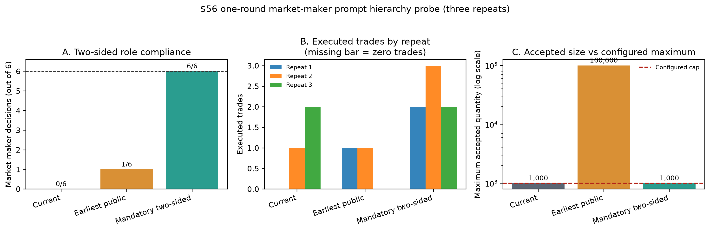

# Market-maker prompt hierarchy mechanism probe

## Executive result

The immediate bottleneck in the $56 market is not a mechanical inability to
place bids. It is a role-compliance conflict in the LLM decision: under the
current market-maker prompt, the agents interpret the asset as overvalued and
sell directionally instead of supplying two-sided liquidity. An explicit rule
that makes a bid and an ask mandatory restored two-sided market-maker quotes in
all six market-maker decisions across three independent one-round repeats.

This is important mechanism evidence, but it is not yet a replication of the
paper's 15-round price path. Executed trade counts remained sensitive to
unstable decisions by the untreated Optimistic agents, even though their exact
rendered prompts, temperature, and seed were unchanged.

## Test design

The test used the $56 initial-price state, eight agents, the
`gpt-4o-2024-11-20` model, temperature 0, LLM seed 42, and simulation seed 42.
Only the market-maker system prompt differed across arms:

1. **Current:** the present repository prompt, which describes liquidity
   provision but permits directional inventory management.
2. **Earliest public:** the byte-exact market-maker prompt extracted from the
   first visible public commit, `027bbf5`.
3. **Mandatory two-sided:** a diagnostic prompt requiring at least one limit
   bid and one limit ask whenever cash and owned inventory permit.

Each arm was run once in each of three repeat sessions. All 72 agent decisions
completed successfully, and the exact rendered prompts and token usage were
retained in each run directory. The three probe sessions cost **$0.353365**.
Including the four earlier full runs, cumulative measured cost was
**$3.255130**, below the $5 soft budget.



## Results

| Prompt arm | Market makers quoting both sides | Market-maker buy orders | Runs with any trade | Total trades | Trades using a market-maker bid | Largest accepted order |
|---|---:|---:|---:|---:|---:|---:|
| Current | 0 / 6 | 0 | 2 / 3 | 3 | 0 | 1,000 |
| Earliest public | 1 / 6 | 1 | 2 / 3 | 2 | 0 | 100,000 |
| Mandatory two-sided | 6 / 6 | 6 | 3 / 3 | 7 | 3 | 1,000 |

The current prompt produced no market-maker bid in any repeat. The earliest
public prompt was not a reliable solution: only one of six market-maker
decisions quoted both sides. The mandatory prompt changed the targeted behavior
cleanly: every market maker submitted both a bid and an ask.

Trade occurrence alone is a weaker outcome than role compliance. In the
current and earliest-public arms, every trade was initiated by an Optimistic
agent's buy order; no market maker supplied the bid. In the mandatory arm,
three of seven trades used a market-maker bid. In the remaining mandatory-arm
trades, Optimistic buyers reached existing asks before a sell reached the
market-maker bid. The treatment therefore robustly created bid liquidity, but
the number and final price of transactions still depended on the other agents'
unstable decisions and matching order.

### Accepted quantity and fill status

The simulator supports partial fills, but no `PARTIALLY_FILLED` state occurred
in any of the nine probe runs. Every transaction was 1,000 shares and consumed
one 1,000-share buy order plus one 1,000-share sell order in full. All other
accepted orders remained completely unfilled.

| Prompt arm | Accepted orders | Accepted quantity (both sides) | Transaction volume | Fully filled order legs | Partially filled | Unfilled orders | All-leg fill rate |
|---|---:|---:|---:|---:|---:|---:|---:|
| Current | 27 | 27,000 | 3,000 | 6 | 0 | 21 | 22.2% |
| Earliest public | 27 | 1,017,000 | 2,000 | 4 | 0 | 23 | 0.39% |
| Mandatory two-sided | 29 | 29,000 | 7,000 | 14 | 0 | 15 | 48.3% |

“Accepted quantity” counts submitted buy and sell order legs separately. A
1,000-share transaction therefore fills 2,000 accepted order-leg shares: 1,000
on the buy side and 1,000 on the sell side. The all-leg fill rate is
`2 × transaction volume / accepted order quantity`.

The earliest-public market makers submitted 1,002,000 accepted order-leg shares
across the three repeats but executed zero. This total consists mainly of ten
100,000-share asks, plus one 1,000-share bid and one 1,000-share ask in the
second repeat. The oversized asks were not partially filled; they received no
fill at all. In the mandatory arm, market makers submitted 12,000 shares across
six bids and six asks. Three bids, totaling 3,000 shares, filled completely;
the other three bids and all six asks remained unfilled.

## Why fixed seed and temperature did not create a matched experiment

The six non-market-maker agents received byte-identical system-plus-user
prompts in all nine runs. Nevertheless, their structured outputs changed.
The clearest example is Optimistic agent 2: one exact prompt produced Buy,
Sell, and Hold decisions and reported valuations of $48, $96, and $100 across
runs. Optimistic agent 3 showed the same three action categories and valuations
of $48 or $96.

Therefore, `temperature=0` and `seed=42` do not provide strict response-level
determinism for this API/model combination. A one-shot comparison can
misattribute untreated model variation to a prompt intervention. Future causal
prompt comparisons need either repeated runs or a replay design that freezes
the untreated agents' responses and varies only the market-maker outputs.

## Concrete implementation defect: the order-size cap is inert

The scenario records `max_order_size=1000`, but the earliest-public prompt
generated between two and four accepted market-maker sell orders of 100,000
shares in every repeat (ten oversized orders in total). The configuration value is defined in
`src/scenarios/base.py`, but it is not consumed by the live order-creation or
order-validation paths. The structured-output schema checks only that quantity
is positive, resource validation checks only cash or inventory, and limit-book
validation checks only price, state, and positive remaining quantity.

This is not merely a prompt-compliance issue: the simulator accepts an order
100 times larger than its declared maximum whenever the agent owns enough
shares. Because the paper scenarios give market makers 200,000 shares, such
orders can materially dominate displayed depth and subsequent matching. Any
liquidity or price-impact analysis should enforce the cap before drawing a
market-level conclusion.

## Mechanism conclusion

The high-price result can now be stated more precisely:

- the $56 state induces directional selling because valuation instructions
  dominate the loosely worded market-making role;
- the market engine is capable of accepting market-maker bids and executing
  against them when the role is made explicit;
- the earliest visible historical prompt does not reliably reconstruct the
  published behavior;
- trade counts and endpoint prices are not reproducible from seed and
  temperature settings alone; and
- the declared maximum order size is currently not enforced.

The result does **not** show that AI herding causes a transaction-based market
crash. It shows a prompt-sensitive failure of liquidity provision: aligned
directional reasoning can remove market-maker bids, after which the simulator's
quote-fallback rule may move its recorded price without a trade.

## Recommended next step

Do not spend the next run budget on the $35/$21 boundary test yet. First:

1. enforce `max_order_size` in both the response schema and runtime order
   validation, with an explicit rejection or deterministic clipping rule;
2. construct a replayable one-round fixture from the recorded responses so that
   untreated agents and order sequence are identical across prompt arms; and
3. repeat the market-maker prompt comparison under that fixture, then run the
   mandatory two-sided arm for 15 rounds using a pre-generated dividend path.

Only after those controls should $35/$21 be used to test whether a narrower
initial-price window independently improves liquidity. Otherwise, prompt-role
failure, untreated-agent nondeterminism, the inactive quantity cap, and the
price boundary all change the observed path at the same time.

## Audit files

- Run-level data: `docs/tables/prompt_hierarchy_probe_runs.csv`
- Arm-level summary: `docs/tables/prompt_hierarchy_probe_aggregate.csv`
- Exact-prompt/output stability: `docs/tables/prompt_hierarchy_agent_stability.csv`
- Run-level fill audit: `docs/tables/prompt_hierarchy_fill_audit.csv`
- Arm-level fill summary: `docs/tables/prompt_hierarchy_fill_aggregate.csv`
- Figure: `docs/figures/prompt_hierarchy_probe.png`
- Offline analysis: `scripts/analyze_prompt_hierarchy_probe.py`
- Paid-run traces: `data/traces/prompt_hierarchy_repeat_{1,2,3}.json`

Regenerate the tables and figure without an API call:

```powershell
python scripts\analyze_prompt_hierarchy_probe.py
```
